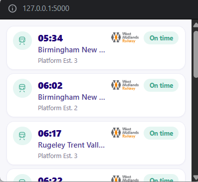
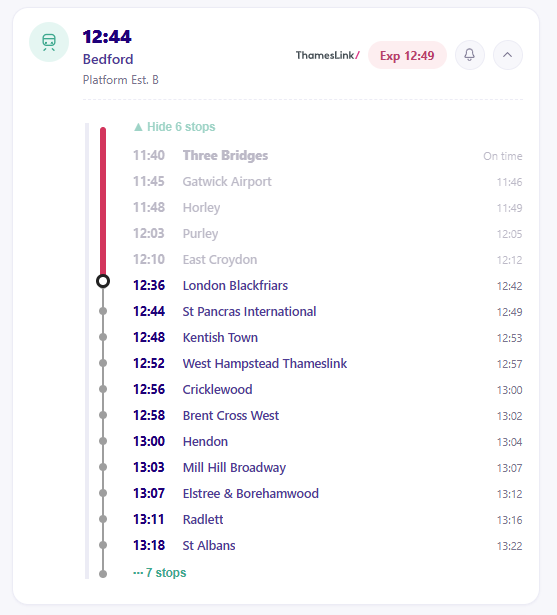

# Train Tracker

A small Flask app that shows live-updating train departures with data from Real Time Trains API, with a
floating "mini player" using by the **Document Picture-in-Picture**
API — the same kind of always-on-top window YouTube uses, but showing
your next train instead of a video.





## Features

*   **Flask + Flask-SocketIO backend:** Pushes live updates directly to connected clients in real time.
*   **Calling Points:** Users can click to expand a train card and view full, stop-by-stop calling points with predicted arrival times.
*   **Desktop Notifications:** Includes an option to enable desktop alerts, notifying you the moment a specific train is delayed or cancelled.
*   **Document Picture-in-Picture:** Includes a floating "mini player" that stays on top of other windows (supported in Chrome/Edge 116+).

## Setup

```bash
python -m venv venv
source venv/bin/activate   # Windows: venv\Scripts\activate
pip install -r requirements.txt
```

You will need to use your API token from https://api-portal.rtt.io/. Set it as a RTT environment variable in an .env file in root of project before running the app:

```
RTT_TOKEN=<Your RTT API Token>
```

Then start the app:

```bash
python app.py
```

Then open **http://localhost:5000** in **Chrome or Edge 116+** (the
Document Picture-in-Picture API is currently Chromium-only).

## Using the mini player

1. Click **"⧉ Mini Player"** in the top bar.
2. A small floating window pops out, showing the same live train list,
   styled to match the main page.
3. It stays on top of other windows/tabs while you do other things —
   drag it anywhere on screen.
4. Close it from its own window controls, or click the button again.

If your browser doesn't support the API, you'll see a fallback message
instead, and the full board still works normally on the page.

## Project structure

```
train-tracker/
├── app.py                # Flask + Socket.IO backend, RTT API integration
├── requirements.txt
├── templates/
│   └── index.html        # Main page markup
├── static/
│   ├── style.css          # Dark theme, shared by main page + PiP window
│   ├── app.js              # Socket.IO client, board rendering, shared state
│   └── pip.js               # Document Picture-in-Picture logic
└── README.md
```

## RTT API integration

The app is wired to call the RTT location endpoint at:

```text
https://data.rtt.io/gb-nr/location
```

It sends the bearer token in the `Authorization` header and uses the
`Version` header plus query parameters such as `code` and `timeWindow`.

The backend converts each RTT service entry into the UI payload shape used
by the app:

- `destination`
- `platform`
- `time`
- `status`
- `expected`

If the bearer token is missing or the request fails, the app will not have
any live departures to display, so make sure the environment variables are
set correctly before launching the server.
